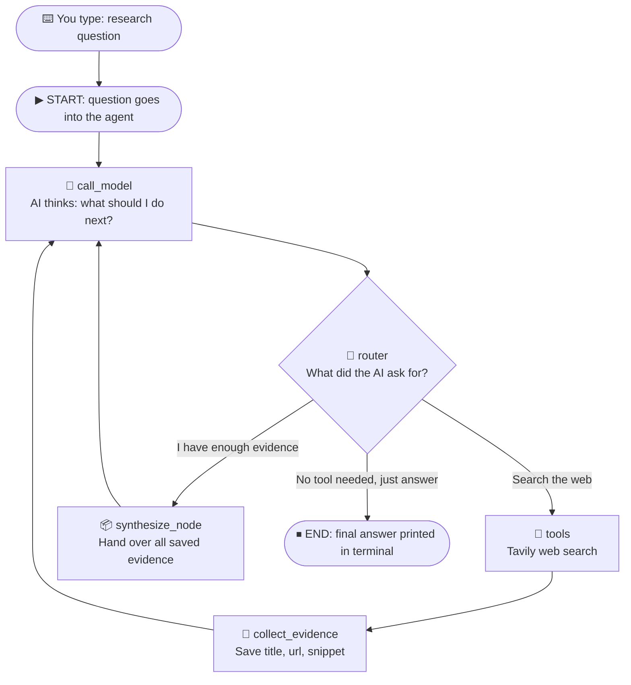

# 🕵️ Python Research Assistant

> **A command-line AI researcher. Type a question in your terminal, and it searches the web by itself, takes notes, and writes a cited answer.**
> Built with **LangGraph**, **Gemini** and **Tavily web search**, to show in the simplest form how an *AI agent* works.

```bash
research "Who are the best characters in Attack on Titan?"        # short, concise answer
research "Who are the best characters in Attack on Titan?" -d     # detailed, structured report
```

---

## 📖 Table of Contents

1. [What is this project?](#-what-is-this-project)
2. [Two modes: simple and detailed](#-two-modes-simple-and-detailed)
3. [Using it as a command-line tool](#-using-it-as-a-command-line-tool)
4. [Normal chatbot vs. research agent](#-normal-chatbot-vs-research-agent)
5. [The big idea: an agent is a loop](#-the-big-idea-an-agent-is-a-loop)
6. [Key words explained simply](#-key-words-explained-simply)
7. [Project structure](#-project-structure)
8. [How the graph works, step by step](#-how-the-graph-works-step-by-step)
9. [Code walkthrough](#-code-walkthrough)
10. [A sample run, in plain English](#-a-sample-run-in-plain-english)
11. [How to install and run](#-how-to-install-and-run)
12. [Tech used](#-tech-used)
13. [Known limitations and ideas](#-known-limitations-and-ideas)

---

## 🎯 What is this project?

You ask a question from your terminal, for example:

> *"Who are the best characters in Attack on Titan?"*

The assistant then:

1. **Decides** it needs to look things up
2. **Searches the web** (as many times as it thinks necessary)
3. **Saves** the useful findings (title, link, snippet) in a notebook
4. **Decides** when it has *enough* evidence
5. **Writes the final answer** using only that evidence, citing the source links and separating facts from uncertainty

The agent lives in [`resAssistant.py`](resAssistant.py), and a small **wrapper bash script** turns it into an everyday terminal command called `research`.

---

## 🎚️ Two modes: simple and detailed

The research process is the same in both modes. What changes is **how the final answer is presented**.

| | 🟢 Simple mode *(default)* | 🔵 Detailed mode |
|---|---|---|
| **How to use** | `research "your question"` | `research "your question" -d` or `--detailed` |
| **Answer style** | Short and concise | Fully structured report |
| **Contains** | The direct answer | Structured **key findings** and a **detailed result** |
| **Best for** | Quick lookups when you just want the answer | Deeper research where you want the full picture |

### Examples

```bash
# Simple mode (the default): a concise answer
research "What is LangGraph?"

# Detailed mode, short flag
research "What is LangGraph?" -d

# Detailed mode, long flag (does exactly the same as -d)
research "What is LangGraph?" --detailed
```

> 💡 **Remember:** if you don't pass any flag, you always get **simple mode**.

---

## 💻 Using it as a command-line tool

### What is a CLI tool?
**CLI** stands for **C**ommand-**L**ine **I**nterface: a program you run by typing a command in the terminal instead of clicking buttons.

You already use CLI tools like `ls`, `git` and `pip`. This project makes the research agent behave the same way: you type `research`, followed by your question.

### Why a wrapper bash script?
Normally, running a Python program needs a long command: activate the right environment, find the file, call `python resAssistant.py ...`. A **wrapper bash script** hides all of that.

```
 You type:        research "your question" -d
                         │
                         ▼
 ┌───────────────────────────────────────┐
 │  Wrapper bash script (named research) │  ← does the boring setup for you
 └───────────────────────────────────────┘
                         │   passes the question and the -d flag along
                         ▼
 ┌───────────────────────────────────────┐
 │  resAssistant.py (the Python agent)   │  ← does the real research
 └───────────────────────────────────────┘
                         │
                         ▼
                 ✅ Answer in your terminal
```

Think of the wrapper as a **shortcut button**: you press `research`, and it quietly runs the long command behind the scenes.

### What the question and the flag mean

| Part of the command | Meaning |
|---|---|
| `research` | The command (the wrapper script) |
| `"your question"` | What you want to research. Use quotes so the whole sentence is treated as one question. |
| `-d` / `--detailed` | *Optional.* Switches from simple mode to detailed mode. |

---

## 🆚 Normal chatbot vs. research agent

| Normal chatbot | This research agent |
|---|---|
| Answers from memory only | Searches the live web first |
| One question → one answer | One question → *think → search → think → search → answer* |
| Can't show where facts came from | Collects source URLs and cites them |
| May be out of date | Uses fresh search results |

**Analogy:** A normal chatbot is like a student answering an exam from memory. This project is like a student who is allowed to go to the library, **take notes**, and then write the essay with references.

---

## 🔁 The big idea: an agent is a loop

The key idea is that the AI is **not following a fixed script**. After every step, *the AI itself decides what to do next*:



Read it like a story:

- **🧠 The AI thinks** → *"I don't know enough. Let me search."*
- **🔎 Search runs** → results come back.
- **📝 Notes are saved** → back to the AI.
- **🧠 The AI thinks again** → *"Still need more"* → search again... or *"I have enough!"*
- **📦 Evidence is handed over** → the AI writes the final answer (short or detailed, depending on the mode) → **END**.

This *think → act → observe → think again* loop is the heart of what people call an **AI agent**.

---

## 🧰 Key words explained simply

| Term | Simple meaning | Where it is in the code |
|---|---|---|
| **LLM** (Large Language Model) | The "brain" that reads text and writes text. Here it is Google Gemini. | `llm = ChatGoogleGenerativeAI(...)` |
| **Tool** | An ability the AI can *choose* to use, like a search engine. The AI can't browse the web by itself, so we give it a tool. | `search_tool` (Tavily) and `synthesize_evidence` |
| **Tool calling** | The AI replying *"please run the search tool with this query"* instead of a normal text answer. | `llm.bind_tools([...])` |
| **Graph** | A flowchart made of boxes and arrows that describes the workflow. | `StateGraph(State)` |
| **Node** | One box in the flowchart: a small job done by a Python function. | `call_model`, `collect_evidence`, `synthesize_node`, `tools` |
| **Edge** | An arrow saying "after this box, go to that box". | `builder.add_edge(...)` |
| **Conditional edge / Router** | A *decision arrow*. A function looks at the situation and chooses which box comes next. | `router` + `add_conditional_edges` |
| **State** | A shared notebook that every node can read and write. | `class State(MessagesState)` |
| **Reducer** | A rule for *how new notes are merged* into the notebook (add to the list instead of replacing it). | `merge_evidence` |
| **Evidence** | The facts collected from the web: `url`, `title`, `snippet`. | `research_evidence` |
| **CLI** | A program you run by typing a command in the terminal. | The `research` command |
| **Wrapper script** | A tiny script that hides a long command behind a short, friendly one. | The bash script behind `research` |

---

## 📁 Project structure

```
Python-Research-Assistant/
│
├── resAssistant.py      # The agent: tools, nodes, router and graph
├── <wrapper script>     # Bash script that exposes the `research` command
└── requirements.txt     # Python dependencies
```

---

## 🪜 How the graph works, step by step

### 🗒️ The State: the shared notebook
Every node reads from and writes to one shared **State**. It holds two things:

1. **`messages`**: the whole conversation (question, AI replies, tool results)
2. **`research_evidence`**: a list of everything useful found on the web

```python
class State(MessagesState):
    research_evidence: Annotated[list[dict], merge_evidence]
```

The `merge_evidence` reducer is a tiny rule: `existing + new`. Without it, each new search would **erase** the previous findings. With it, evidence **piles up** across searches. 📚

### 🧠 Node 1: `call_model`: *the thinker*
Sends the conversation so far to Gemini. Gemini answers with one of three things:

- 🔎 "Run a web search for ..." *(a tool call)*
- ✅ "I'm ready to wrap up: call `synthesize_evidence`" *(a special tool call)*
- 💬 A normal text reply with no tool *(the final answer)*

### 🔀 The `router`: *the decision-maker*
Looks at the AI's last message and picks the next box:

| AI's message contains | Router sends us to |
|---|---|
| No tool call at all | **END** (it's the final answer) |
| A `synthesize_evidence` call | **synthesize_node** |
| Any other tool call (search) | **tools** |

### 🔎 Node 2: `tools`: *the searcher*
Runs the **Tavily** web search and returns up to **3 results** per search (`max_results=3`).

### 📝 Node 3: `collect_evidence`: *the note-taker*
Takes the raw search results and keeps just three useful fields from each one: **url**, **title** and **snippet**. These are added to `research_evidence` in the State. Then control goes back to the thinker.

### 📦 Node 4: `synthesize_node`: *the hand-over*
When the AI says "I have enough", this node packages **all the saved evidence** and gives it back to the AI as a tool reply. The AI then reads all the notes at once and writes the final cited answer, in **simple** or **detailed** form depending on the mode you chose.

> 💡 **A neat trick:** `synthesize_evidence` doesn't do any real work. It is a *signal tool*. Calling it is just the AI's way of saying *"stop searching, I'm ready to write"*. The real work happens in `synthesize_node`.

---

## 🔬 Code walkthrough

| What you want to understand | Where to look in [`resAssistant.py`](resAssistant.py) |
|---|---|
| The shared notebook and the merge rule | `merge_evidence`, `class State` |
| The AI brain | `llm = ChatGoogleGenerativeAI(...)` |
| The web search tool (3 results max) | `search_tool = TavilySearch(...)` |
| The "I'm done searching" signal | `@tool def synthesize_evidence()` |
| Giving the AI its tools | `llm.bind_tools([search_tool, synthesize_evidence])` |
| The thinker | `call_model(state)` |
| The decision logic | `router(state)` |
| The note-taker | `collect_evidence(state)` |
| The hand-over of evidence | `synthesize_node(state)` |
| Wiring nodes and arrows together | `builder = StateGraph(State)` … `builder.compile()` |
| Reading the question and the `-d` / `--detailed` flag | The command-line handling in `resAssistant.py` |
| Turning the Python file into the `research` command | The wrapper bash script |

### The instructions given to the AI
The prompt tells the agent how to behave:

- Use web search when more information is needed
- Call `synthesize_evidence` when enough evidence has been gathered
- After receiving the evidence, write the final answer from it
- Don't call `synthesize_evidence` twice for the same task
- **Cite source URLs and distinguish supported facts from uncertainty**

In **simple mode** the final answer is kept concise. In **detailed mode** it is written as a structured report with key findings and a detailed result.

---

## 🎬 A sample run, in plain English

Command: `research "Who are the best characters in Attack on Titan?" -d`

```
 0. ⌨️ CLI:      the wrapper passes the question and the -d flag to the agent
 1. 🧠 AI:      "I need information about fan opinions." → asks for a web search
 2. 🔀 Router:  search requested → go to tools
 3. 🔎 Search:  3 results come back
 4. 📝 Notes:   url + title + snippet of each saved to research_evidence
 5. 🧠 AI:      "Let me check one more angle." → asks for another search
 6. 🔎📝 Search again → 3 more results saved (the old ones are kept!)
 7. 🧠 AI:      "That's enough." → calls synthesize_evidence
 8. 🔀 Router:  synthesize requested → go to synthesize_node
 9. 📦 Hand-over: all saved evidence given back to the AI
10. 🧠 AI:     writes the final answer: key findings + detailed result + source links
11. 🔀 Router: no tool call → END ✅
```

Without `-d`, steps 1–9 are the same, but step 10 produces a short, concise answer instead.

> The number of searches isn't fixed. The AI decides. That's what makes it an *agent*.

---

## ▶️ How to install and run

### 1. Clone the repo
```bash
git clone https://github.com/samudra3/Python-Research-Assistant.git
cd Python-Research-Assistant
```

### 2. Install the requirements
```bash
pip install -r requirements.txt
pip install langchain
```
*(`langchain` is imported in the code for the `@tool` decorator, so it is installed here to be safe.)*

### 3. Add your API keys
Create a `.env` file in the project folder:
```
GOOGLE_API_KEY=your_gemini_api_key
TAVILY_API_KEY=your_tavily_api_key
```
- Gemini key: [Google AI Studio](https://aistudio.google.com/)
- Tavily key: [tavily.com](https://tavily.com/) (has a free tier)

### 4. Make the `research` command available
The wrapper script must be **executable** and placed in a folder that is on your system `PATH`, so you can run it from anywhere:

```bash
chmod +x research                 # make the wrapper script executable
# then either add this project folder to your PATH...
export PATH="$PATH:/path/to/Python-Research-Assistant"
# ...or link it into a folder that is already on your PATH:
sudo ln -s /path/to/Python-Research-Assistant/research /usr/local/bin/research
```
*(Adjust the file name and paths to match your wrapper script. To keep the PATH change permanently, add the `export` line to your `~/.bashrc` or `~/.zshrc`.)*

### 5. Use it 🎉
```bash
research "your question"          # simple mode (default): concise answer
research "your question" -d       # detailed mode: structured key findings + detailed result
research "your question" --detailed   # same as -d
```

---

## 🛠 Tech used

| Purpose | Tool |
|---|---|
| Language | Python |
| Agent workflow (graph, nodes, edges, state) | [LangGraph](https://github.com/langchain-ai/langgraph) |
| The AI model | Google Gemini via `langchain-google-genai` |
| Web search | [Tavily](https://tavily.com/) via `langchain-tavily` |
| Loading secret keys | `python-dotenv` |
| Command-line tool | Wrapper bash script |

---

## ⚠️ Known limitations and ideas

This is a **learning project**, kept small on purpose:

- There is **no loop limit**, so in theory the AI could keep searching. Adding a maximum number of searches would make it safer.
- The `router` sends the AI to `synthesize_node` as soon as it sees `synthesize_evidence`. If the AI ever asks for a search *and* synthesize in the *same* message, that search would be skipped.
- It only searches the web, with 3 results per search. It does not read the full pages, only the snippets.
- The wrapper script is written for Linux/macOS-style terminals (bash).

**Ideas to extend it:**
- Add a maximum search count
- Add more tools (Wikipedia, a PDF reader, a calculator)
- Save the final report to a file (for example with an `-o` option)
- Add a third mode, such as a one-line answer

---

## 🎯 Key takeaway

> **A research agent = an AI brain + tools + a notebook + a loop that lets the AI decide when it's done. The CLI wrapper just makes it a single command away.**

---

⭐ If this project helped you understand AI agents, consider giving it a star!
